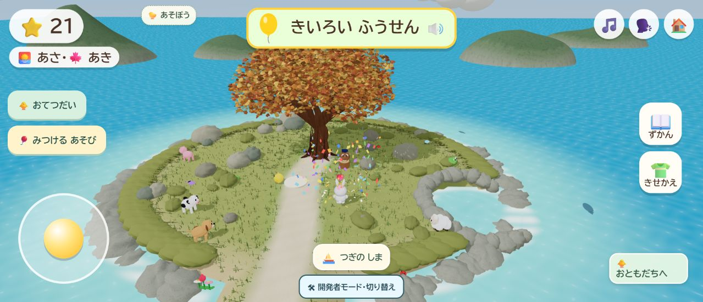
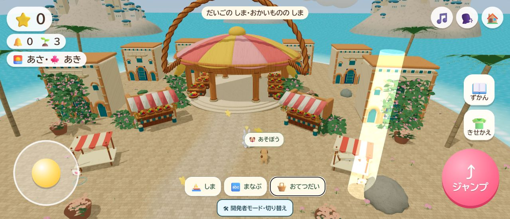

# 歩行・実物遊びの復元を公開

2026-10-19、本人の「公開まで進めて」に従い、[PR #43](https://github.com/futsalife24-bot/Ichi-game/pull/43)をmainへ反映した。

- 公開先：https://futsalife24-bot.github.io/Ichi-game/
- 公開前main：`619308b0d209b0cacf9d8b33747f10884ea119c4`
- 別Chat監査合格の実装：`d6470d6253cb3b3a8c31219be7e2f0aa24525f18`
- 統合検証済み作業HEAD：`793ea620a52f000ba254ecb54fbcac78b7409e9d`
- 公開main：`2b17916dc1e6ce206ef10ebd458995330b1ad96e`
- 作業ブランチ：`codex/restore-world-play`
- ローカル：`C:/Users/futsa/Documents/Codex/2026-10-03/codex-ichi-game-futsalife24-bot-ichi/work/Ichi-game`

## 統合と検査

main側の既存リファクタリング5モジュールを保持。競合はPROJECT.mdだけで、双方の履歴を残した。統合後の全441テストが成功し、追加の独立担当による統合差分レビューでも必須不具合なし。別Chat監査の合格対象と、この追加統合確認は区別する。主担当・追加担当の実モデルIDと推論設定は未確認。

[main必須検査](https://github.com/futsalife24-bot/Ichi-game/actions/runs/39164698742)、[Pages公開](https://github.com/futsalife24-bot/Ichi-game/actions/runs/39164698736)とも成功。コード・素材・音声969件のHTTP応答とSHA256を公開mainのGit原本に照合し、全件一致。[配信結果](world-play-release-check.json)。

## 公開版の画面確認

Chromeの公開URLで通常タイトルを確認。既存プロフィールを変更しない開発者モードの一時データで、第一島の実物風船の開始、移動補助、取得、星20→21を確認。第五島は起動、おてつだいから実際のお店への目印・徒歩案内、スティックによる位置変化を確認。両画面の警告・エラーは0。第五島の活動完走を公開版で再検証した記録ではない。活動の詳細確認は[実装時の検証](world-play-restoration.md)を参照。

実スマートフォンの性能、本人・子どもの体験評価、全44活動の人によるブラウザー完走は未確認。公開後の記録差分は文書・検証結果・画像のみで、作業ブランチへ保存する。無関係な未追跡ログと監査用ローカル資料は保持する。
